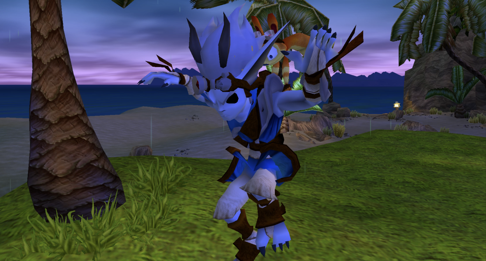

# Past Dark Jak

Lore-accurate Dark Jak skin in the original TPL outfit.



By [hector.studio](https://hector.studio), commissioned by Minimum-Chip-2166.

*Cosmetic only. No Dark Eco powers or transformation mechanics.*

## Installation

1. Install Jak and Daxter: The Precursor Legacy in the [OpenGOAL Launcher](https://opengoal.dev/).
2. Download your platform’s archive from [Releases](https://github.com/hectorlizard/past-dark-jak/releases).
3. In the Launcher, open **Jak 1 → Features → Mods → Add Mod from File** and select the archive.
4. Wait for installation, then launch the mod.

Built with OpenGOAL 0.3.3. Tested on macOS Intel with NTSC-U v1.
Other platforms and game editions are untested. Installs separately from the original game.

For the full title, description and artwork in the Launcher, add this URL in **Settings → Mods**:

```text
https://raw.githubusercontent.com/hectorlizard/past-dark-jak/main/mods.json
```

## Credits

- Hector: skin and model adaptation.
- Naughty Dog / Sony: original characters and assets.
- OpenGOAL: PC port and tools.

## Building a bundle

Run `python3 tools/package.py windows` (or `linux`, `macos-intel`, `macos-arm`).
This adds the replacement model to the official OpenGOAL 0.3.3 bundle.
